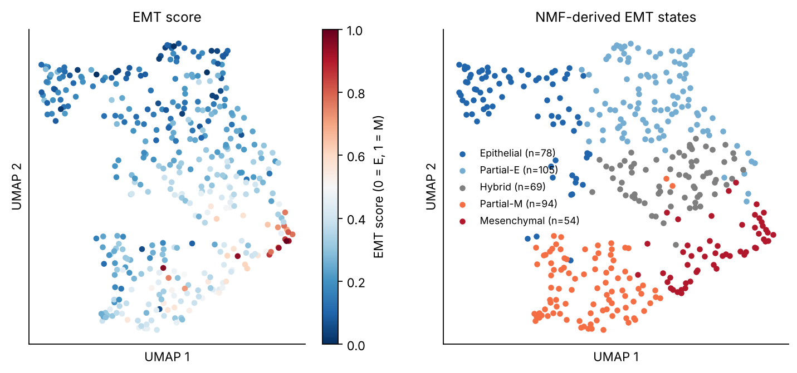
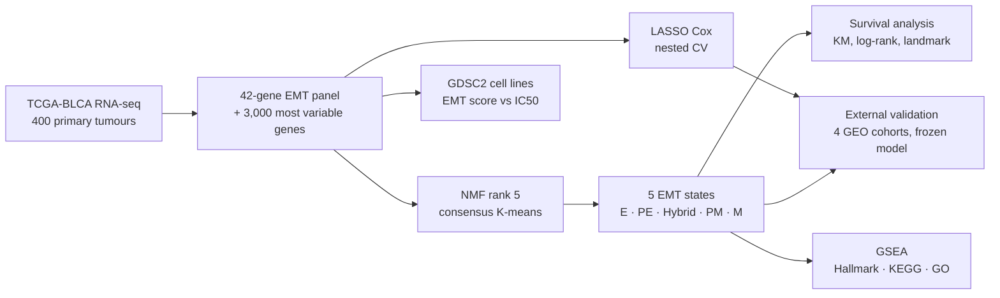
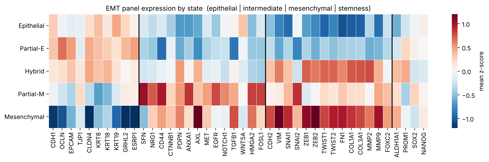
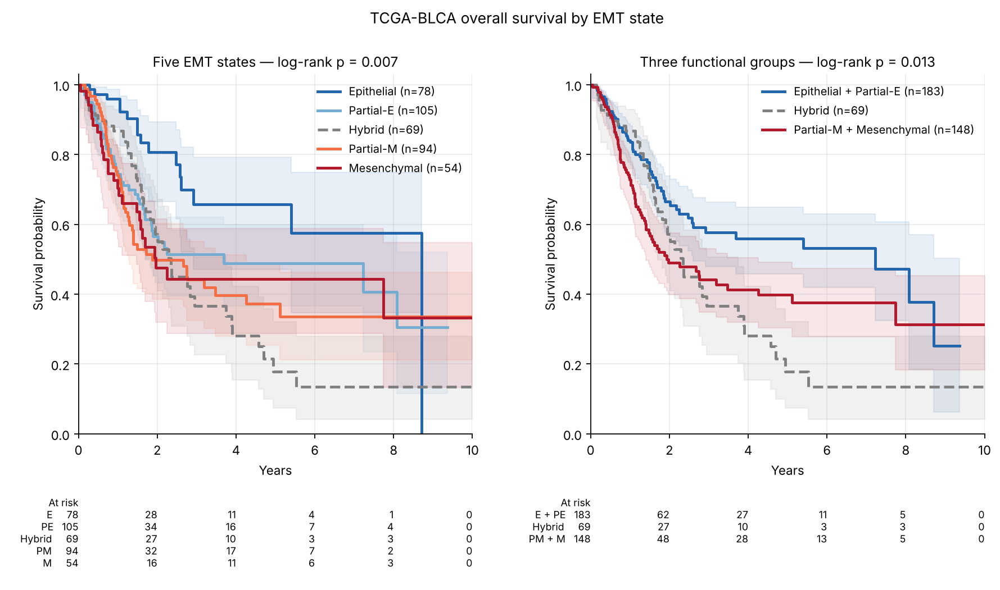
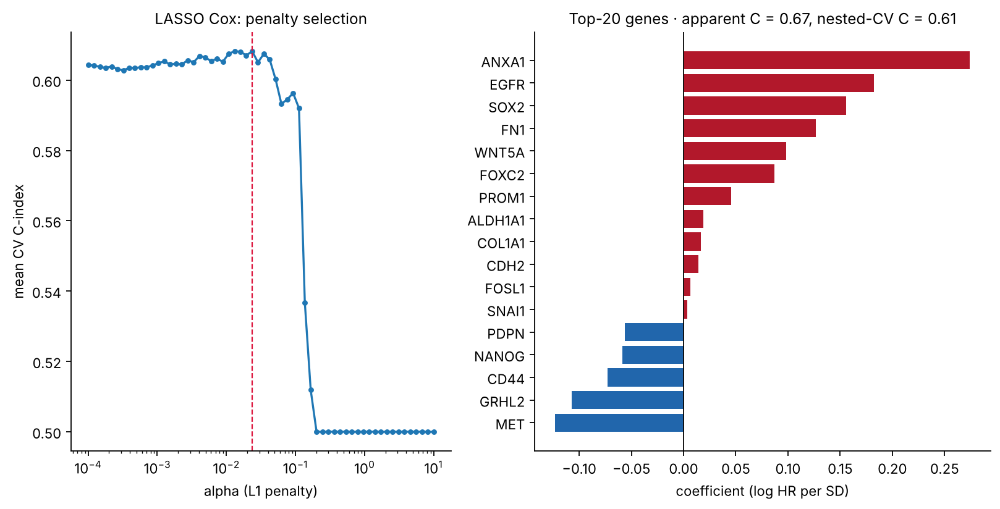
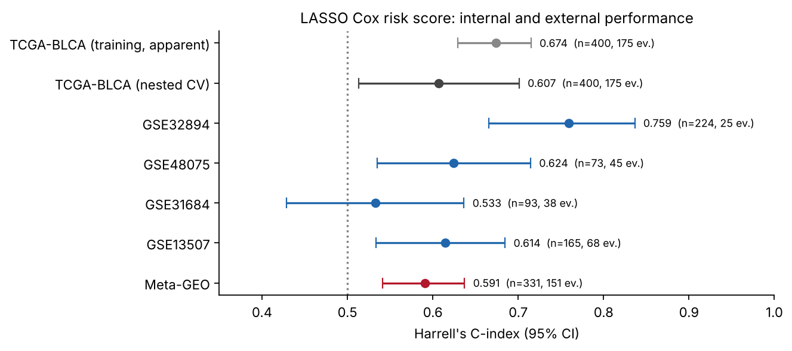
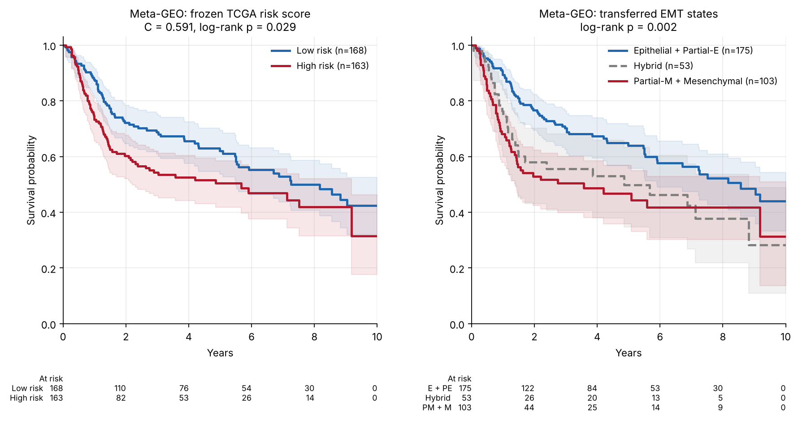
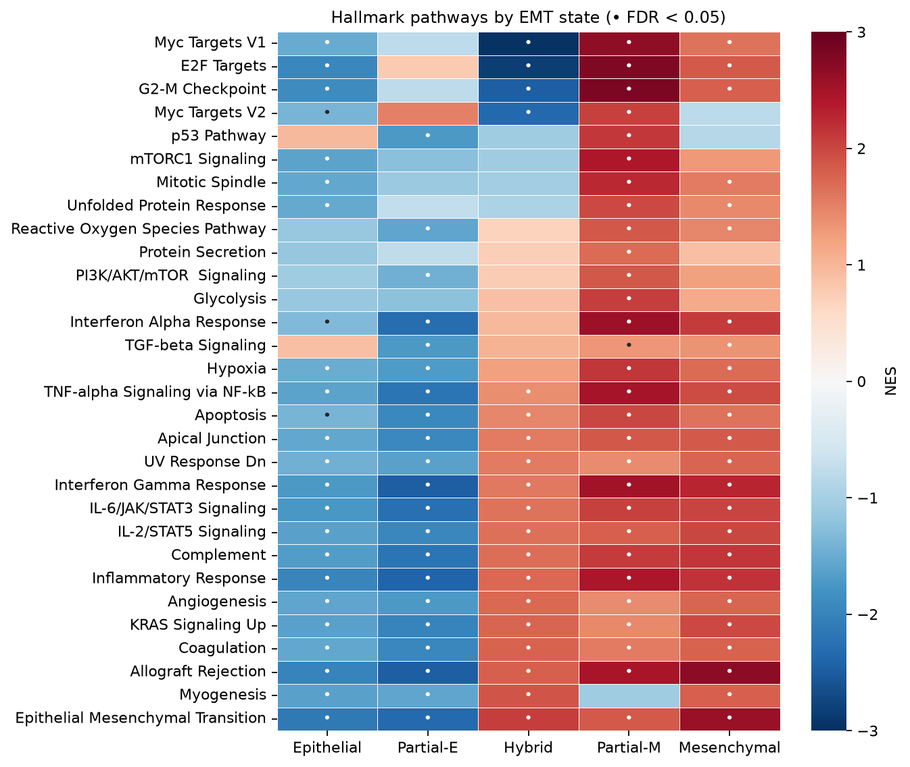
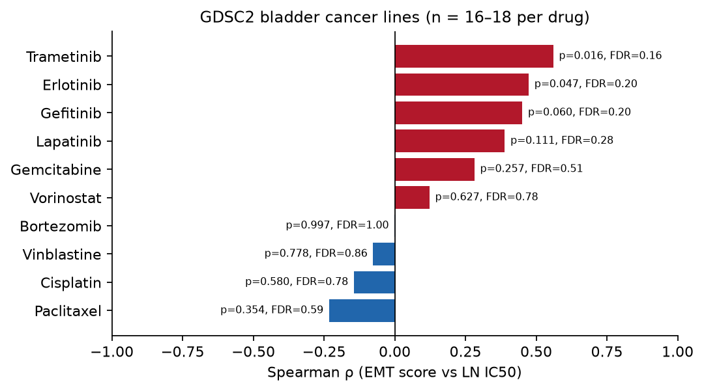

# Hybrid EMT states and survival in muscle-invasive bladder cancer


A reproducible pipeline that resolves **discrete epithelial–mesenchymal transition (EMT) states** in bladder tumours from bulk RNA-seq, tests whether they carry **prognostic information**, and checks the findings in **four independent cohorts** and in **drug-sensitivity data from cell lines**.

It is the computational part of my BSc thesis, *"The role of epithelial–mesenchymal transition in the development of chemoresistance in bladder cancer"* (HSE University, 2026).

<p align="center"></p>

## Key findings

| | Result |
|---|---|
| **EMT states** | NMF + consensus clustering of 400 TCGA-BLCA tumours yields five states along the E → M axis. These include a **Hybrid state (n = 69)** that co-expresses epithelial (CLDN4, KRT8/18) and mesenchymal programmes (ZEB1/2, TWIST1/2, COL1A1/3A1, FN1). |
| **Prognosis** | Overall survival differs between states (log-rank p = 0.007). The median is **7.2 years for epithelial-like tumours vs 2.4 years for Hybrid** (BH-adjusted p = 0.023). Hybrid and mesenchymal-like tumours are not distinguishable overall (p = 0.88). |
| **Late mortality** | Among patients alive at 2 years, Hybrid tumours have higher mortality than mesenchymal-like ones: **HR 4.05 (95% CI 1.77–9.30)**, p < 0.001. This is exploratory, with only 27 Hybrid patients. |
| **Risk model** | A 42-gene LASSO Cox model selects 17 genes. **Nested-CV C-index 0.607 ± 0.048**; the apparent C-index of 0.674 is optimistic. The cross-fitted risk score stays independent of age and stage: **HR 1.31 per SD (1.12–1.53)**, p < 0.001. |
| **Biology** | GSEA on the full transcriptome shows **"invasion without proliferation"** in the Hybrid state. EMT, angiogenesis and ECM programmes are up, while MYC, E2F and G2/M targets and ribosome biogenesis are among the most depleted gene sets in any state. Partial-M and Mesenchymal tumours, in contrast, are highly proliferative. |
| **External validation** | With frozen TCGA coefficients, C-index is **0.591 in a pooled meta-cohort of 331 patients** and 0.53–0.76 in individual cohorts. Transferred EMT states separate survival in 3 of 4 cohorts (meta-cohort p = 0.002). Hybrid tumours do worse than epithelial-like ones in GSE32894, GSE13507 and the meta-cohort. |

The internal nested-CV estimate (0.61) and the external meta-cohort estimate (0.59) agree. The panel carries a **modest but reproducible** prognostic signal, and the reported numbers are what an independent dataset should be expected to give.

## Pipeline



| Step | Script | What it does |
|---|---|---|
| 0 | `00_download_data.py` | Fetches TCGA (UCSC Xena) and GEO data; lists the manual downloads |
| 1 | `01_preprocess_tcga.py` | Primary tumours (one per patient), OS censored at 10 years, 42-gene panel, gene symbols |
| 2 | `02_emt_states.py` | Anchor-marker EMT score; NMF on the 3,000 most variable genes; consensus K-means; states ordered E → M |
| 3 | `03_survival_model.py` | KM / log-rank (BH-adjusted), LASSO Cox with nested CV, cross-fitted multivariable Cox, 2-year landmark |
| 4 | `04_external_validation.py` | Frozen risk score and nearest-centroid transfer of EMT states to GSE32894, GSE48075, GSE31684, GSE13507 |
| 5 | `05_gsea.py` | GSEA prerank of each state vs the rest on the full Hallmark, KEGG 2021 and GO BP 2023 libraries |
| 6 | `06_gdsc_drug_response.py` | EMT score of 40 bladder cell lines vs LN IC50 for 12 drugs (Spearman, BH-FDR) |

## Results

### 1. Five EMT states in TCGA-BLCA
<p align="center"></p>

The NMF rank was chosen at the elbow of the reconstruction error (rank 5, [figure](figures/02_nmf_elbow.png)). Consensus K-means on the NMF weights is run with **k = 5, one cluster per programme**. Clusters are ordered by mean z(M anchors) − mean z(E anchors). The EMT score differs strongly between states (Kruskal–Wallis p = 6 × 10⁻⁴⁸, Spearman ρ = 0.71). Within-state consensus ranges from 0.79 to 0.96 ([figure](figures/02_consensus_matrix.png)).

### 2. EMT states and overall survival
<p align="center"></p>

| Group | n | Deaths | Median OS, years (95% CI) |
|---|---:|---:|---|
| Epithelial + Partial-E | 183 | 60 | 7.23 (2.60–NR) |
| Hybrid | 69 | 40 | 2.35 (1.71–3.74) |
| Partial-M + Mesenchymal | 148 | 75 | 1.97 (1.40–4.26) |

The Hybrid curve stays close to the mesenchymal one for the first ~2 years and then keeps falling. The [landmark analysis](figures/03_landmark_2y.png) of 2-year survivors (n = 137, 36 deaths) isolates this late excess mortality: Hybrid vs Partial-M + Mesenchymal **HR 4.05**, p < 0.001. Epithelial-like vs mesenchymal-like tumours show no difference after the landmark (p = 0.71).

### 3. LASSO Cox risk model
<p align="center"></p>

The penalty is selected by 5-fold CV. Performance is estimated by **nested cross-validation**: 5 × 5 outer folds, with the penalty re-tuned inside every training fold. Risk groups and the [multivariable model](figures/03_multivariable_cox.png) use the cross-fitted risk score, where each patient is scored by a model that never saw them.

| Model | HR per SD (95% CI) | p |
|---|---|---|
| LASSO risk score (cross-fitted) | 1.31 (1.12–1.53) | 8 × 10⁻⁴ |
| Age | 1.35 (1.15–1.59) | 3 × 10⁻⁴ |
| Stage (I–IV) | 1.48 (1.26–1.73) | 1 × 10⁻⁶ |

Strongest adverse genes: ANXA1, EGFR, SOX2, FN1, WNT5A, FOXC2. Strongest protective: MET, GRHL2, CD44, NANOG, PDPN ([table](results/lasso_cox_coefficients.csv)).

### 4. External validation
<p align="center"></p>

| Cohort | Platform | Endpoint | n | Events | C-index (95% CI) | EMT groups log-rank |
|---|---|---|---:|---:|---|---|
| GSE32894 (Sjödahl 2012) | Illumina HT-12 v3 | disease-specific death | 224 | 25 | 0.759 (0.665–0.836) | p < 0.001 |
| GSE48075 (Choi 2014), cT2+ | Illumina HT-12 v3 | OS | 73 | 45 | 0.624 (0.535–0.714) | p = 0.019 |
| GSE31684 (Riester 2012) | Affymetrix U133 Plus 2 | disease-specific death | 93 | 38 | 0.533 (0.428–0.636) | p = 0.51 |
| GSE13507 (Kim 2010) | Illumina Human-6 v2 | OS | 165 | 68 | 0.614 (0.533–0.685) | p = 0.006 |
| **Meta-GEO** (GSE13507 + GSE31684 + GSE48075) | — | OS / DSS | 331 | 151 | **0.591 (0.541–0.637)** | **p = 0.002** |

Every gene is z-scored within its cohort, and the TCGA coefficients are applied **without refitting**. EMT states are transferred with a **nearest-centroid classifier** trained on the TCGA NMF labels. It recovers the NMF state of 72% of held-out TCGA tumours, against 20% by chance. GSE32894 has only 25 events, so its high C-index should not be over-read.

<p align="center"></p>

### 5. Pathways (GSEA)
<p align="center"></p>

Each state is compared with all other tumours (Welch t-statistic ranking, 1,000 permutations) on the complete Hallmark (50), KEGG 2021 (320) and GO Biological Process 2023 (5,406) libraries.

| Hallmark (NES) | Epithelial | Partial-E | **Hybrid** | Partial-M | Mesenchymal |
|---|---:|---:|---:|---:|---:|
| Epithelial–mesenchymal transition | −2.14 | −2.33 | **+2.07** | +1.85 | +2.60 |
| Angiogenesis | −1.58 | −1.72 | **+1.73** | +1.41 | +1.76 |
| MYC targets V1 | −1.50 | −0.79 | **−2.97** | +2.67 | +1.62 |
| E2F targets | −1.97 | +0.79 | **−2.86** | +2.80 | +1.84 |
| G2/M checkpoint | −1.89 | −0.79 | **−2.47** | +2.82 | +1.80 |

All Hybrid values have FDR < 0.001. The Hybrid state is the only one that combines an active EMT/ECM programme with strongly *suppressed* proliferation, and the same split is seen in KEGG (Ribosome, Spliceosome ↓) and GO BP (ribosome biogenesis ↓, ECM organisation ↑). A slow-cycling, invasive phenotype would be consistent with late rather than early mortality, though this remains a hypothesis. Immune and stromal sets (allograft rejection, B-cell receptor signalling, myogenesis) are also up in Hybrid tumours, so part of the signal probably comes from the tumour microenvironment ([Hybrid top pathways](figures/05_hybrid_top_pathways.png), [all results](results/gsea_significant.csv)).

### 6. Drug sensitivity of bladder cancer cell lines (GDSC2)
<p align="center"></p>

The anchor-marker EMT score of 40 bladder cancer cell lines (Cell Model Passports RNA-seq) is correlated with LN IC50 for 10 drugs with GDSC2 data, using 16–18 lines per drug and BH correction across drugs. The score orders the lines as expected: RT4, SW780 and RT-112 are the most epithelial; T24, J82, UM-UC-3 and TCCSUP are among the most mesenchymal ([scores](results/gdsc_cell_line_emt_scores.csv)).

- **No association with the standard chemotherapy drugs** (cisplatin ρ = −0.14, gemcitabine ρ = 0.28; both p > 0.25).
- The strongest trend is **resistance of mesenchymal lines to the MEK inhibitor trametinib** (ρ = 0.56, p = 0.016), with weaker trends for the EGFR inhibitors erlotinib and gefitinib (ρ ≈ 0.45–0.47). **None survives FDR correction** (trametinib FDR = 0.16). With 18 lines this is a hypothesis to test, not a finding.

## Sensitivity and limitations

- **Number of states.** Silhouette slightly prefers k = 4 (0.47 vs 0.44 at k = 5). At k = 4 the Hybrid tumours are split between Partial-E and Partial-M. The Hybrid state is therefore tied to the 5-state resolution, which is pre-specified to match the NMF rank.
- **Hybrid vs mesenchymal.** Hybrid tumours do worse than epithelial-like ones in TCGA and in three external datasets. They are **not** distinguishable from mesenchymal-like tumours overall. The late-mortality signal comes from a post-hoc landmark analysis of 27 patients and needs independent confirmation.
- **Heterogeneous validation data.** Different platforms, endpoints (OS vs disease-specific death) and case mixes (GSE13507 includes non-muscle-invasive tumours). Within-cohort z-scoring removes location and scale differences, but not every batch effect.
- **Bulk RNA-seq** averages tumour, stromal and immune cells. Part of the "mesenchymal" and Hybrid signal is stromal and immune content (see GSEA), so a single-cell or deconvolution analysis is the natural next step.
- **Cell-line drug response** rests on 16–18 lines per drug, and no association survives multiple-testing correction.
- **Associations, not causation.** TCGA is a retrospective cohort with heterogeneous treatment.

## Version history

| Version | Notes |
|---|---|
| **1.0** (2026) | Original thesis pipeline, registered with Rospatent (see below) |
| **2.0** (Nov 2026) | Refactored into a package plus numbered scripts, all English. **Fixed a double log-transform**: the Xena matrix is already log2(TPM+1) and v1 applied log2(x+1) again. Added nested-CV and cross-fitted evaluation, correct administrative censoring, BH-FDR for GDSC, nearest-centroid transfer of states to external cohorts (v1 used quantiles of a 1-D score), complete gene-set libraries for GSEA (v1 used 30 hand-picked sets), and a 2-year landmark analysis. All numbers in this README come from v2. |

## How to run

```bash
git clone https://github.com/LittleIronclad/bladder-cancer-emt-states
cd bladder-cancer-emt-states
pip install -r requirements.txt
python scripts/00_download_data.py      # automatic downloads + list of manual ones (data/README.md)
./run_pipeline.sh                       # or run scripts/01_… to 06_… individually
```

Steps 1–4 take about 2 minutes on a laptop CPU; GSEA (step 5) takes a few minutes more and needs internet access on its first run to fetch the gene-set libraries. Results are identical on Linux and macOS (Apple M4). Fixed seeds (42) make every stochastic step deterministic.

```
emt/            config (paths, gene panel, parameters) and reusable code: data loading, scoring, survival
scripts/        numbered pipeline steps
results/        summary tables produced by the pipeline
figures/        figures produced by the pipeline
data/           input data (not tracked; see data/README.md)
```

## Registered software · citation

The original version of this software is registered with the Russian Federal Service for Intellectual Property (Rospatent):

> **Software for NMF clustering of hybrid epithelial–mesenchymal states and LASSO Cox survival prediction in bladder cancer.** Certificate of State Registration of a Computer Program **No. 2026691679**, registered 14 October 2026. Author and rights holder: A. N. Potemkin.
> *(Russian title: «Программа для NMF-кластеризации гибридных эпителиально-мезенхимальных состояний и LASSO Cox-прогнозирования выживаемости при раке мочевого пузыря».)*

Please cite via [`CITATION.cff`](CITATION.cff).

Thesis supervisor: Prof. E. V. Stepanova. Consultant: M. M. Chetverikova (HSE University). Public data: TCGA Research Network, GEO submitters (Sjödahl et al., Choi et al., Riester et al., Kim et al.), Wellcome Sanger Institute (GDSC, Cell Model Passports).

## Author

**Alexey Potemkin**, MSc Bioinformatics student, University of Tübingen · [LinkedIn](https://www.linkedin.com/in/alexey-potemkin-567bb3364/) · alex.n.potemkin@gmail.com
